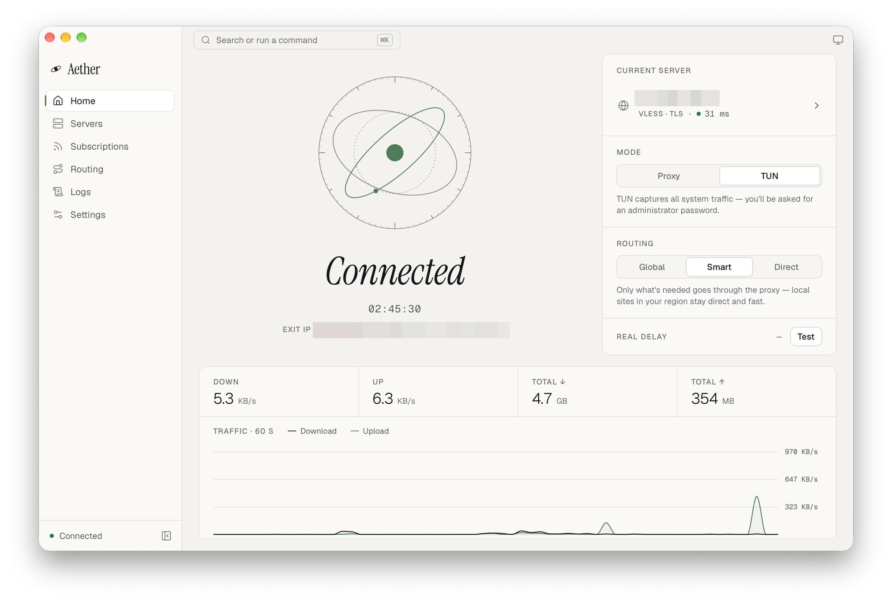
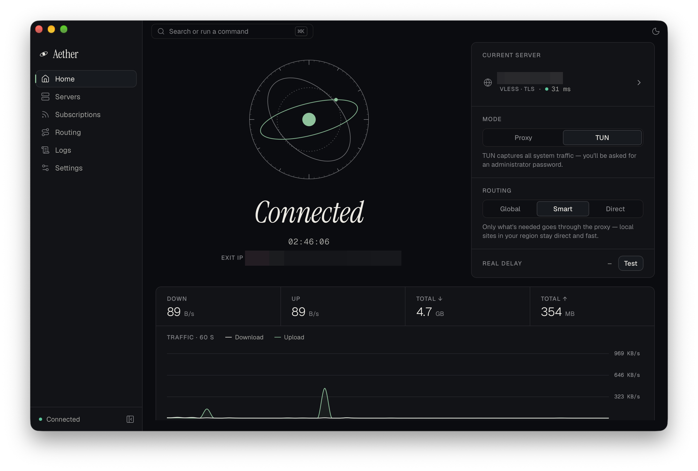
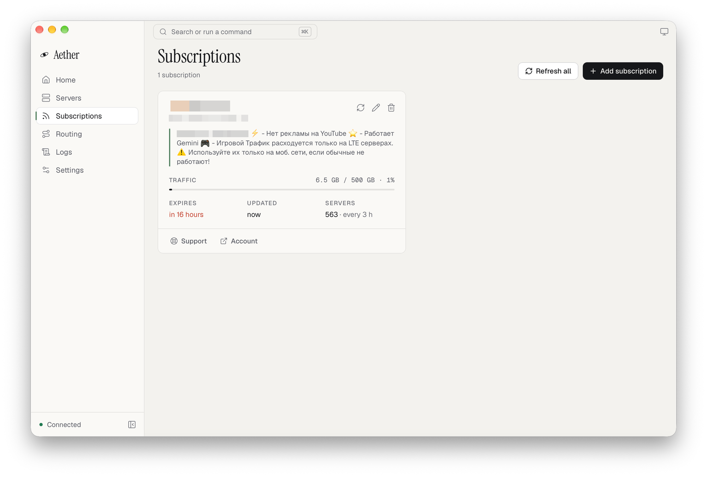
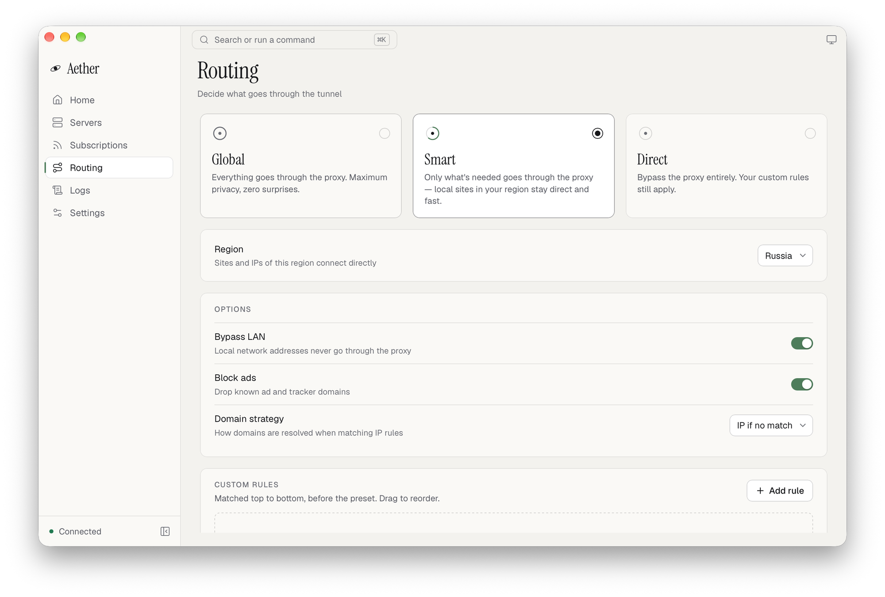
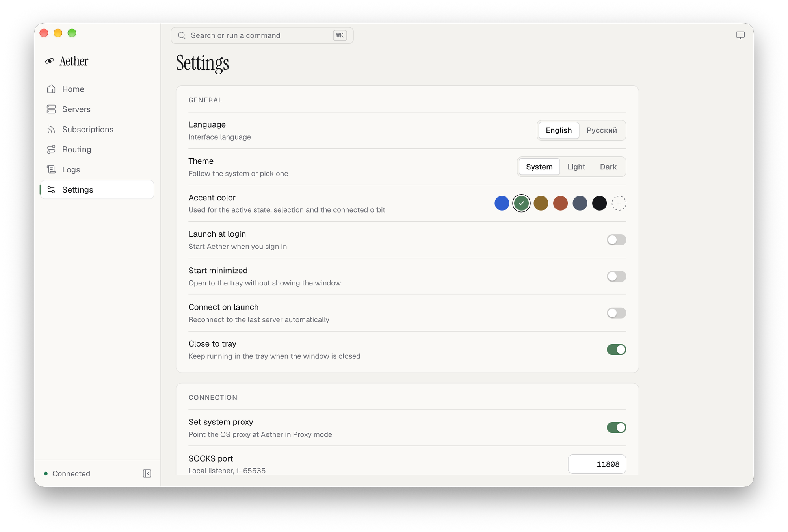

<div align="center">


# Aether

**A fast, good-looking desktop VPN client for [Xray-core](https://github.com/XTLS/Xray-core).**

Rust ([Tauri 2](https://tauri.app)) does all the work; the UI is React + TypeScript.

[](https://github.com/vlppz/aether-vpn/releases/latest)
[](https://github.com/vlppz/aether-vpn/actions/workflows/release.yml)
[](https://github.com/vlppz/aether-vpn/releases)


 **English** ·  [Русский](README.ru.md)

[**Download**](#download) · [Features](#features) · [Screenshots](#screenshots) · [Build from source](#building) · [How it works](#how-a-connection-works)

<br>

<picture>
  <source media="(prefers-color-scheme: dark)" srcset="docs/screenshots/home-dark.png">
  
</picture>

</div>

## Download

| Platform | File |
|---|---|
| **macOS** — Apple Silicon | [`Aether_<version>_aarch64.dmg`](https://github.com/vlppz/aether-vpn/releases/latest) |
| **macOS** — Intel | [`Aether_<version>_x64.dmg`](https://github.com/vlppz/aether-vpn/releases/latest) |
| **Windows** — x64 installer | [`Aether_<version>_x64-setup.exe`](https://github.com/vlppz/aether-vpn/releases/latest) |
| **Windows** — x64 MSI | [`Aether_<version>_x64_en-US.msi`](https://github.com/vlppz/aether-vpn/releases/latest) |

Every build ships with a pinned, SHA-256-verified Xray-core and the geo databases, so there is nothing else to install.

> [!NOTE]
> Builds are not notarized or code-signed yet.
> **macOS:** if it says the app *can't be opened* or *is damaged*, run `xattr -cr /Applications/Aether.app` once, or allow it in System Settings → Privacy & Security → *Open Anyway*.
> **Windows:** in the SmartScreen prompt, click *More info* → *Run anyway*.

## Features

- 🔌 **Every popular protocol** — VLESS (REALITY, Vision, XHTTP, WS, gRPC, HTTPUpgrade, mKCP), VMess, Trojan, Shadowsocks (incl. 2022), SOCKS, Hysteria2 (Salamander obfs, port hopping), and raw Xray JSON configs.
- 📡 **Subscriptions that just work** — base64, plain text, or JSON (Remnawave/Marzban style). Shows traffic, expiry, announcements, support and account links from the `subscription-userinfo`, `profile-title`, `profile-update-interval`, `support-url`, `profile-web-page-url` and `announce` headers (or `#key: value` lines in the body). Auto-refresh, fetched through the tunnel when it is up.
- 🛡️ **Two modes** — *System proxy*, or *TUN*, which captures all traffic through Xray's native `tun` inbound. On macOS, one password prompt installs the helper; later connects need none.
- 🧭 **Smart routing** — Global / Smart (region-local sites go direct: RU, CN, IR…) / Direct presets, ad blocking, LAN bypass, and drag-to-reorder custom rules (domain, IP, process, port → proxy / direct / block).
- ⏱️ **Real-delay testing** — every server is tested through a throw-away Xray instance with a real HTTPS request, so UDP protocols like Hysteria2 and CDN-fronted servers get honest numbers.
- ✨ **Thoughtful details** — live traffic graph, exit IP and country, logs console, tray menu, ⌘K command palette, paste-anywhere import, `aether://` deep links, launch at login, light/dark themes with custom accent colors, English and Russian.

## Screenshots

<table>
  <tr>
    <td width="50%"></td>
    <td width="50%"></td>
  </tr>
  <tr>
    <td align="center"><sub><b>Home</b> — connection, mode, routing and live traffic</sub></td>
    <td align="center"><sub><b>Dark theme</b></sub></td>
  </tr>
  <tr>
    <td width="50%"></td>
    <td width="50%"></td>
  </tr>
  <tr>
    <td align="center"><sub><b>Subscriptions</b> — traffic, expiry and provider announcements</sub></td>
    <td align="center"><sub><b>Routing</b> — presets, region, options and custom rules</sub></td>
  </tr>
  <tr>
    <td width="50%"></td>
    <td width="50%"></td>
  </tr>
  <tr>
    <td align="center"><sub><b>Settings</b> — language, theme, accent color, startup and connection</sub></td>
    <td></td>
  </tr>
</table>

## Layout

```
crates/aether-core/    pure logic, no GUI: share links ⇄ model, subscriptions, Xray config builder
crates/aether-helper/  tiny privileged helper that runs Xray for TUN mode
src-tauri/             the app: connection engine, system proxy, latency, tray, commands
ui/                    React UI (works standalone in a browser with a mock backend)
scripts/               fetch-core.{sh,ps1}, prepare-sidecars.mjs, e2e-local.sh
```

The UI ↔ backend contract lives in `ui/src/lib/types.ts`. Every type there mirrors a serde struct in `src-tauri`.

### How a connection works

1. `aether-core::build_xray_config` turns the selected server and settings into an Xray 26 config. It contains SOCKS/HTTP inbounds (the SOCKS port also speaks HTTP), `proxy`/`direct`/`block`/`dns-out` outbounds, DNS, routing rules, and a metrics endpoint for live traffic.
2. **Proxy mode:** the bundled `xray` sidecar runs as your user. Aether waits for the SOCKS port, then points the OS proxy at it. Before changing the OS proxy, Aether saves your previous settings, and restores them on disconnect, quit, Ctrl-C, or the next launch after a crash.
3. **TUN mode:** Xray 26 only *creates* the TUN interface (name + MTU); everything else is done by `aether-helper` as root:
   - binds every Xray outbound to the physical interface (`sockopt.interface`) so the proxy's own traffic never re-enters the tunnel;
   - resolves server hostnames *before* touching routes/DNS and hands them to Xray via `dns.hosts` — otherwise Xray would look up its own server through the tunnel (deadlock);
   - installs split routes (`1/8 … 128/1`, `2000::/3`) that beat the default route, and removes them on disconnect;
   - points system DNS at `1.1.1.1` inside the tunnel (hijacked to Xray's DNS module). IPv6 is always captured; with IPv6 off, DNS returns A records only and stray IPv6 is refused — so nothing leaks around the tunnel.

   Aether also refuses to start TUN while another VPN owns the routes, and verifies after connecting that traffic really goes through its interface.

   **How the helper is started:**
   - **macOS:** a launchd daemon (`/Library/LaunchDaemons/app.aether.vpn.helper.plist`) installed on the first TUN connect with **one** password prompt; later connects need none. It runs root-owned copies of the helper and Xray from `/Library/PrivilegedHelperTools/app.aether.vpn`, listens on `/var/run/app.aether.vpn.helper.sock`, serves only the uid that installed it (checked with the peer's credentials), and ends each session when the app disconnects or quits. When the bundled helper or Xray changes, Aether reinstalls it automatically (one prompt). Remove it in Settings → TUN → VPN service, or `sudo /Library/PrivilegedHelperTools/app.aether.vpn/aether-helper uninstall`.
   - **Linux / Windows:** launched per connection through `pkexec` / UAC; it connects back to a socket Aether owns and proves itself with a one-time token from a `0600` file.

Helper hardening: it only executes the `xray` binary next to itself, copies the config to a private file and strips log file paths (so a crafted config can't make root write files), and never outlives its IPC connection.

## Building

Requirements: Rust (stable), Node 20+, pnpm. On Linux you also need the [Tauri system deps](https://tauri.app/start/prerequisites/) (webkit2gtk-4.1, libayatana-appindicator3), plus `pkexec` for TUN mode.

```sh
scripts/fetch-core.sh            # Xray v26.11.9 for your host (sha256-verified) + geo files
                                 # Windows: powershell -File scripts\fetch-core.ps1  (adds wintun.dll)
pnpm --dir ui install
pnpm --dir ui tauri dev          # run the app
pnpm --dir ui tauri build        # .app/.dmg, .msi/.exe, .deb/.AppImage
```

`tauri dev` and `tauri build` first run `scripts/prepare-sidecars.mjs`, which builds `aether-helper` and copies it next to the Xray sidecar.

Only working on the UI? Run `pnpm --dir ui dev` and open http://localhost:1420. Without Tauri, the UI uses a realistic in-memory mock backend.

### Releases

Pushing a `v*` tag runs [`.github/workflows/release.yml`](.github/workflows/release.yml), which builds macOS (Apple Silicon + Intel) and Windows (x64) and publishes them as a GitHub release:

```sh
git tag v0.1.0 && git push origin v0.1.0
```

Keep the tag in sync with `version` in `src-tauri/tauri.conf.json`.

## Testing

```sh
cargo test --workspace                                   # link parsing, subscriptions, config snapshots, store, logs…
XRAY_BIN=$PWD/src-tauri/binaries/xray-$(rustc -vV | sed -n 's/^host: //p') \
  cargo test -p aether-core -- --ignored                 # `xray run -test` on every generated config × routing preset
cargo clippy --workspace --all-targets
scripts/e2e-local.sh                                     # real app ↔ real local Xray servers (see below)
pnpm --dir ui typecheck && pnpm --dir ui lint && pnpm --dir ui test
```

`scripts/e2e-local.sh` starts local VLESS+REALITY+Vision, Shadowsocks-2022, VLESS+XHTTP and Trojan+WS servers. For each one it launches the real (debug) app with an isolated data dir, imports the share link and connects. It then checks:
- HTTPS through both inbounds;
- traffic counters and real-delay latency;
- the OS proxy is set (macOS, first case);
- SIGTERM stops Xray and restores the proxy.

To test the helper/IPC path without a password prompt, set `AETHER_TUN_NO_ELEVATE=1`. Unprivileged, Xray then fails to create the interface, and the app surfaces that error cleanly.

### Manual TUN checklist (needs admin)
1. Settings → mode **TUN**, connect, approve the system prompt.
2. `curl https://ipwho.is` *without* any proxy flags shows the server's IP.
3. `netstat -rn` (macOS/Linux) or `route print` (Windows) shows routes via the TUN interface.
4. Disconnect: routes are gone, DNS is back to its previous servers, and no `aether-helper` process is left.

## Environment variables

| Variable | Purpose |
|---|---|
| `AETHER_DATA_DIR` | Use a different data directory (profiles/settings) |
| `AETHER_TUN_NO_ELEVATE` | Start the TUN helper without an elevation prompt |
| `AETHER_E2E_LINK` | *Debug builds:* import + connect this link on start (used by e2e) |
| `XRAY_VERSION` | Override the Xray release fetched by `fetch-core` |
| `RUST_LOG` | Backend log filter, e.g. `aether=debug` |

## Notes and limitations
- Xray 26 removed `allowInsecure`. Links that set it without a `pinSHA256` are imported, but the flag is ignored, so self-signed servers need a certificate pin.
- In TUN mode, the latency test's own connections also go through the tunnel, so they measure server latency *via* the current server.
- Linux and Windows still ask for elevation on every TUN connect (a systemd unit / Windows service would remove that, like the macOS daemon does).

## License

[MIT](LICENSE). Aether bundles [Xray-core](https://github.com/XTLS/Xray-core) (MPL-2.0) and, on Windows, [Wintun](https://www.wintun.net) — each under its own license.
