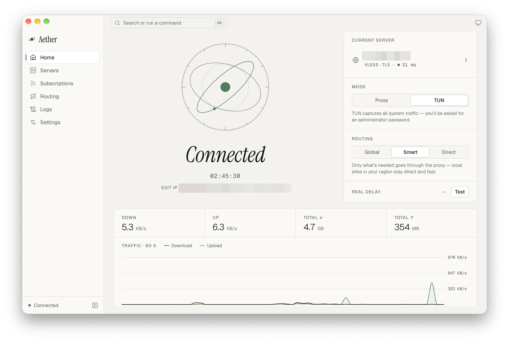
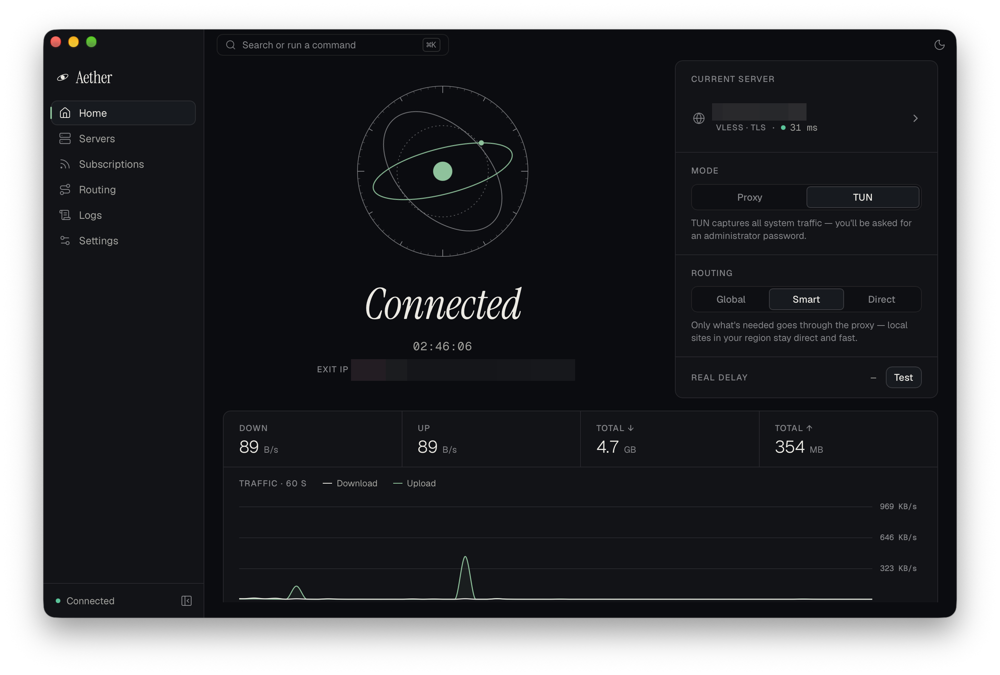
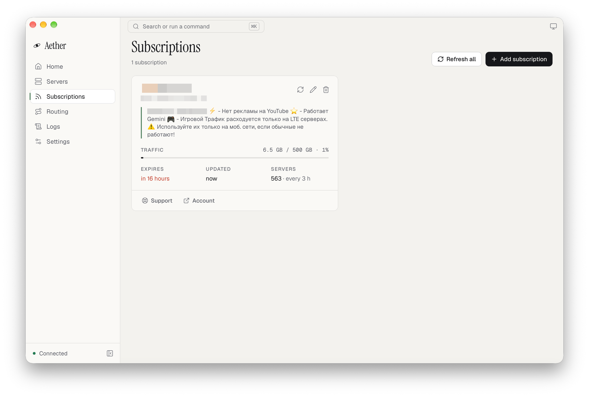
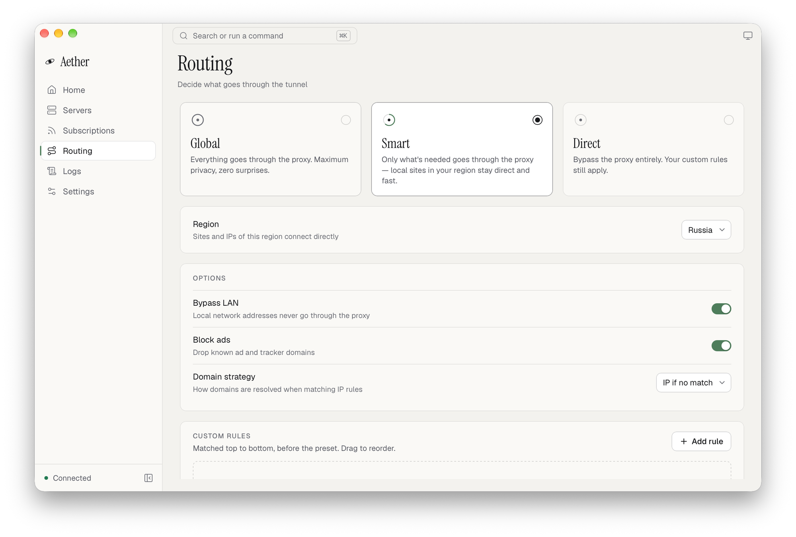
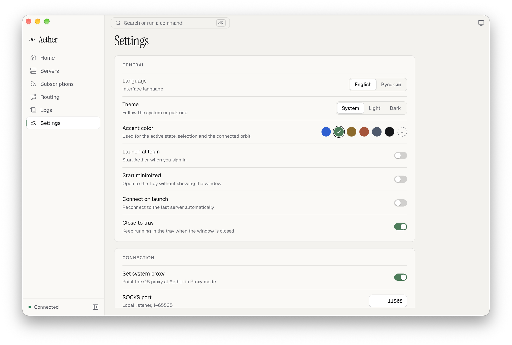

<div align="center">


# Aether

**Быстрый и красивый десктопный VPN-клиент для [Xray-core](https://github.com/XTLS/Xray-core).**

Всю работу делает Rust ([Tauri 2](https://tauri.app)), интерфейс — React + TypeScript.

[](https://github.com/vlppz/aether-vpn/releases/latest)
[](https://github.com/vlppz/aether-vpn/actions/workflows/release.yml)
[](https://github.com/vlppz/aether-vpn/releases)


 [English](README.md) ·  **Русский**

[**Скачать**](#скачать) · [Возможности](#возможности) · [Скриншоты](#скриншоты) · [Сборка](#сборка) · [Как это работает](#как-устроено-подключение)

<br>

<picture>
  <source media="(prefers-color-scheme: dark)" srcset="docs/screenshots/home-dark.png">
  
</picture>

</div>

## Скачать

| Платформа | Файл |
|---|---|
| **macOS** — Apple Silicon | [`Aether_<версия>_aarch64.dmg`](https://github.com/vlppz/aether-vpn/releases/latest) |
| **macOS** — Intel | [`Aether_<версия>_x64.dmg`](https://github.com/vlppz/aether-vpn/releases/latest) |
| **Windows** — x64, установщик | [`Aether_<версия>_x64-setup.exe`](https://github.com/vlppz/aether-vpn/releases/latest) |
| **Windows** — x64, MSI | [`Aether_<версия>_x64_en-US.msi`](https://github.com/vlppz/aether-vpn/releases/latest) |

В каждую сборку входят зафиксированная версия Xray-core (с проверкой SHA-256) и гео-базы — больше ничего ставить не нужно.

> [!NOTE]
> Сборки пока не нотаризованы и не подписаны.
> **macOS:** если система пишет, что приложение *не удаётся открыть* или *оно повреждено*, один раз выполните `xattr -cr /Applications/Aether.app` или разрешите запуск в «Системные настройки» → «Конфиденциальность и безопасность» → *«Всё равно открыть»*.
> **Windows:** в окне SmartScreen нажмите *«Подробнее»* → *«Выполнить в любом случае»*.

## Возможности

- 🔌 **Все популярные протоколы** — VLESS (REALITY, Vision, XHTTP, WS, gRPC, HTTPUpgrade, mKCP), VMess, Trojan, Shadowsocks (включая 2022), SOCKS, Hysteria2 (обфускация Salamander, port hopping) и «сырые» JSON-конфиги Xray.
- 📡 **Подписки, которые просто работают** — base64, обычный текст или JSON (в стиле Remnawave/Marzban). Показывает трафик, срок действия, объявления, ссылки на поддержку и личный кабинет из заголовков `subscription-userinfo`, `profile-title`, `profile-update-interval`, `support-url`, `profile-web-page-url` и `announce` (или строк `#key: value` в теле). Автообновление; при включённом туннеле подписки загружаются через него.
- 🛡️ **Два режима** — *системный прокси* или *TUN*, который захватывает весь трафик через нативный `tun`-инбаунд Xray. На macOS пароль запрашивается один раз при установке хелпера — дальше подключение без запросов.
- 🧭 **Умная маршрутизация** — пресеты «Глобальный» / «Умный» (сайты своего региона идут напрямую: RU, CN, IR…) / «Напрямую», блокировка рекламы, обход локальной сети и пользовательские правила с перетаскиванием (домен, IP, процесс, порт → прокси / напрямую / блок).
- ⏱️ **Проверка реальной задержки** — каждый сервер проверяется через отдельный временный экземпляр Xray настоящим HTTPS-запросом, поэтому UDP-протоколы вроде Hysteria2 и серверы за CDN получают честные цифры.
- ✨ **Продуманные мелочи** — живой график трафика, внешний IP и страна, консоль логов, меню в трее, палитра команд ⌘K, импорт вставкой из буфера в любом месте, deep links `aether://`, автозапуск, светлая и тёмная темы со своим акцентным цветом, английский и русский языки.

## Скриншоты

<table>
  <tr>
    <td width="50%"></td>
    <td width="50%"></td>
  </tr>
  <tr>
    <td align="center"><sub><b>Главная</b> — подключение, режим, маршрутизация и трафик в реальном времени</sub></td>
    <td align="center"><sub><b>Тёмная тема</b></sub></td>
  </tr>
  <tr>
    <td width="50%"></td>
    <td width="50%"></td>
  </tr>
  <tr>
    <td align="center"><sub><b>Подписки</b> — трафик, срок действия и объявления провайдера</sub></td>
    <td align="center"><sub><b>Маршрутизация</b> — пресеты, регион, опции и свои правила</sub></td>
  </tr>
  <tr>
    <td width="50%"></td>
    <td width="50%"></td>
  </tr>
  <tr>
    <td align="center"><sub><b>Настройки</b> — язык, тема, акцентный цвет, запуск и подключение</sub></td>
    <td></td>
  </tr>
</table>

## Структура проекта

```
crates/aether-core/    чистая логика без GUI: ссылки ⇄ модель, подписки, сборка конфига Xray
crates/aether-helper/  маленький привилегированный хелпер, запускающий Xray в режиме TUN
src-tauri/             само приложение: движок подключения, системный прокси, задержки, трей, команды
ui/                    React-интерфейс (работает и отдельно в браузере с мок-бэкендом)
scripts/               fetch-core.{sh,ps1}, prepare-sidecars.mjs, e2e-local.sh
```

Контракт UI ↔ бэкенд описан в `ui/src/lib/types.ts`. Каждый тип там повторяет serde-структуру из `src-tauri`.

### Как устроено подключение

1. `aether-core::build_xray_config` превращает выбранный сервер и настройки в конфиг Xray 26. В нём есть SOCKS/HTTP-инбаунды (SOCKS-порт понимает и HTTP), аутбаунды `proxy`/`direct`/`block`/`dns-out`, DNS, правила маршрутизации и эндпоинт метрик для живого трафика.
2. **Режим прокси:** встроенный сайдкар `xray` запускается от вашего пользователя. Aether ждёт, пока откроется SOCKS-порт, и направляет на него системный прокси. Перед изменением системного прокси Aether сохраняет прежние настройки и восстанавливает их при отключении, выходе, Ctrl-C или при следующем запуске после сбоя.
3. **Режим TUN:** Xray 26 только *создаёт* TUN-интерфейс (имя + MTU); всё остальное делает `aether-helper` от root:
   - привязывает каждый аутбаунд Xray к физическому интерфейсу (`sockopt.interface`), чтобы собственный трафик прокси никогда не попадал обратно в туннель;
   - резолвит адреса серверов *до* изменения маршрутов и DNS и передаёт их Xray через `dns.hosts` — иначе Xray искал бы собственный сервер через туннель (взаимоблокировка);
   - ставит разделённые маршруты (`1/8 … 128/1`, `2000::/3`), которые приоритетнее маршрута по умолчанию, и убирает их при отключении;
   - направляет системный DNS на `1.1.1.1` внутри туннеля (перехватывается DNS-модулем Xray). IPv6 захватывается всегда; при выключенном IPv6 DNS отдаёт только A-записи, а случайный IPv6-трафик отклоняется — так ничего не утекает мимо туннеля.

   Aether также не запускает TUN, пока маршруты занимает другой VPN, и после подключения проверяет, что трафик действительно идёт через его интерфейс.

   **Как запускается хелпер:**
   - **macOS:** launchd-демон (`/Library/LaunchDaemons/app.aether.vpn.helper.plist`) устанавливается при первом подключении в режиме TUN с **одним** запросом пароля; последующие подключения обходятся без него. Он запускает принадлежащие root копии хелпера и Xray из `/Library/PrivilegedHelperTools/app.aether.vpn`, слушает `/var/run/app.aether.vpn.helper.sock`, обслуживает только uid, который его установил (проверяется по учётным данным собеседника сокета), и завершает сессию, когда приложение отключается или закрывается. Если встроенный хелпер или Xray обновились, Aether автоматически переустанавливает его (один запрос). Удалить — «Настройки» → TUN → VPN-служба, или `sudo /Library/PrivilegedHelperTools/app.aether.vpn/aether-helper uninstall`.
   - **Linux / Windows:** запускается на каждое подключение через `pkexec` / UAC; подключается обратно к сокету, которым владеет Aether, и подтверждает себя одноразовым токеном из файла с правами `0600`.

Защита хелпера: он запускает только бинарник `xray`, лежащий рядом с ним, копирует конфиг в приватный файл и вырезает пути к лог-файлам (чтобы подложенный конфиг не заставил root писать файлы), и никогда не переживает своё IPC-соединение.

## Сборка

Нужны: Rust (stable), Node 20+, pnpm. На Linux также нужны [системные зависимости Tauri](https://tauri.app/start/prerequisites/) (webkit2gtk-4.1, libayatana-appindicator3) и `pkexec` для режима TUN.

```sh
scripts/fetch-core.sh            # Xray v26.11.9 для вашей платформы (с проверкой sha256) + гео-файлы
                                 # Windows: powershell -File scripts\fetch-core.ps1  (плюс wintun.dll)
pnpm --dir ui install
pnpm --dir ui tauri dev          # запустить приложение
pnpm --dir ui tauri build        # .app/.dmg, .msi/.exe, .deb/.AppImage
```

`tauri dev` и `tauri build` сначала запускают `scripts/prepare-sidecars.mjs`, который собирает `aether-helper` и кладёт его рядом с сайдкаром Xray.

Работаете только над интерфейсом? Запустите `pnpm --dir ui dev` и откройте http://localhost:1420. Без Tauri интерфейс использует реалистичный мок-бэкенд в памяти.

### Релизы

Пуш тега `v*` запускает [`.github/workflows/release.yml`](.github/workflows/release.yml): он собирает macOS (Apple Silicon + Intel) и Windows (x64) и публикует их как релиз на GitHub:

```sh
git tag v0.1.0 && git push origin v0.1.0
```

Тег должен совпадать с `version` в `src-tauri/tauri.conf.json`.

## Тестирование

```sh
cargo test --workspace                                   # разбор ссылок, подписки, снапшоты конфигов, хранилище, логи…
XRAY_BIN=$PWD/src-tauri/binaries/xray-$(rustc -vV | sed -n 's/^host: //p') \
  cargo test -p aether-core -- --ignored                 # `xray run -test` для каждого конфига × пресета маршрутизации
cargo clippy --workspace --all-targets
scripts/e2e-local.sh                                     # настоящее приложение ↔ настоящие локальные серверы Xray (см. ниже)
pnpm --dir ui typecheck && pnpm --dir ui lint && pnpm --dir ui test
```

`scripts/e2e-local.sh` поднимает локальные серверы VLESS+REALITY+Vision, Shadowsocks-2022, VLESS+XHTTP и Trojan+WS. Для каждого он запускает настоящее (debug) приложение с изолированной папкой данных, импортирует ссылку и подключается. Затем проверяет:
- HTTPS через оба инбаунда;
- счётчики трафика и реальную задержку;
- что системный прокси установлен (macOS, первый случай);
- что SIGTERM останавливает Xray и восстанавливает прокси.

Чтобы проверить путь хелпер/IPC без запроса пароля, задайте `AETHER_TUN_NO_ELEVATE=1`. Без привилегий Xray не сможет создать интерфейс, и приложение аккуратно покажет эту ошибку.

### Ручная проверка TUN (нужны права администратора)
1. «Настройки» → режим **TUN**, подключитесь, подтвердите системный запрос.
2. `curl https://ipwho.is` *без* каких-либо флагов прокси показывает IP сервера.
3. `netstat -rn` (macOS/Linux) или `route print` (Windows) показывает маршруты через TUN-интерфейс.
4. Отключитесь: маршрутов нет, DNS вернулся к прежним серверам, процессов `aether-helper` не осталось.

## Переменные окружения

| Переменная | Назначение |
|---|---|
| `AETHER_DATA_DIR` | Другая папка данных (профили/настройки) |
| `AETHER_TUN_NO_ELEVATE` | Запускать TUN-хелпер без запроса повышения прав |
| `AETHER_E2E_LINK` | *Только debug-сборки:* импортировать эту ссылку и подключиться при запуске (используется в e2e) |
| `XRAY_VERSION` | Переопределить версию Xray, которую скачивает `fetch-core` |
| `RUST_LOG` | Фильтр логов бэкенда, например `aether=debug` |

## Заметки и ограничения
- В Xray 26 убрали `allowInsecure`. Ссылки, где он задан без `pinSHA256`, импортируются, но флаг игнорируется, поэтому для серверов с самоподписанным сертификатом нужен пин сертификата.
- В режиме TUN собственные соединения теста задержки тоже идут через туннель, поэтому они измеряют задержку сервера *через* текущий сервер.
- Linux и Windows пока запрашивают повышение прав при каждом подключении TUN (systemd-юнит / служба Windows избавили бы от этого, как демон на macOS).

## Лицензия

[MIT](LICENSE). Aether включает [Xray-core](https://github.com/XTLS/Xray-core) (MPL-2.0) и, на Windows, [Wintun](https://www.wintun.net) — каждый под своей лицензией.
